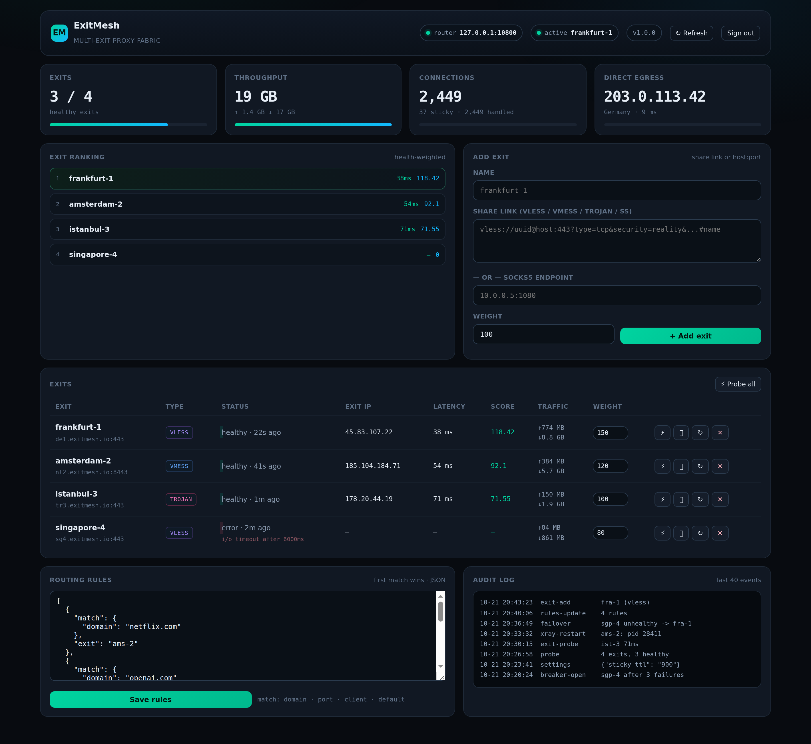

# ExitMesh

**One stable SOCKS5 endpoint in front of many upstream exits — health-ranked, sticky, self-healing.**

You have ten proxies: some VLESS, some VMess, some SOCKS5 boxes in other countries. Your
scripts keep pointing at the dead one, your scrapers lose their session, and you have no idea
which exit burned 40 GB last night. ExitMesh turns that pile into a single local port.

```
                       ┌──────────────────────────────────────────┐
  curl / browser /     │              ExitMesh                    │
  scraper / bot  ──────┤  :10800  SOCKS5 router                   │
                       │            │                             │
                       │            ├── selector ── rules          │
                       │            │      ├── health score       │
                       │            │      ├── circuit breaker    │
                       │            │      └── sticky sessions    │
                       │            │                             │
                       │     ┌──────┴──────┬──────────┬─────────┐ │
                       │  :20000       :20001     :20002    ...  │
                       │  xray/vless   xray/vmess  xray/ss       │
                       └──────┬──────────┬──────────┬─────────┘
                              ▼          ▼          ▼
                          frankfurt   amsterdam   singapore
```

<p align="center">
  
</p>

## Why this exists

Most "proxy pool" projects are a rotating list and a `random.choice()`. That fails in three
ways: it sends traffic to dead exits, it breaks sessions that need a stable IP, and it tells
you nothing about where your bandwidth went. ExitMesh is built around the three things that
actually matter in production:

**Health-aware ranking.** Every exit is probed on a schedule: real latency *and* its real
egress IP (not just "port is open"). Ranking is a score, not a coin flip:

```
score = weight × health_factor / (1 + latency_ms/120) / (1 + consecutive_failures × 0.5)
```

A dead exit scores `0` and is never chosen. A flapping exit is penalised until it proves
itself again.

**Sticky sessions.** A client keeps the same exit for `sticky_ttl` seconds (default 15 min),
so logins, carts and scraping sessions survive. The table is keyed by client address and
expires on its own.

**Per-exit accounting.** Up/down bytes, connection count and failure count per exit, batched
into SQLite every few seconds — no write per packet.

## Features

- **Any upstream format** — paste a `vless://`, `vmess://`, `trojan://` or `ss://` share link
  and ExitMesh generates, validates and supervises an isolated Xray instance for it. Already
  have SOCKS5 boxes? Add `host:port` and you're done.
- **Automatic failover** — if the chosen exit refuses mid-connection, the next best one is
  tried before the client sees an error.
- **Circuit breaker** — N consecutive failures open the breaker with exponential backoff
  (15s → 300s); a single success closes it.
- **Routing rules** — first match wins, on `domain` (suffix or glob), `port`, `client` CIDR/glob,
  or `default`. Actions: `auto`, a specific exit, `direct`, or `block`.
- **Process supervision** — dead Xray processes are restarted by the probe loop; configs are
  validated with `xray run -test` before they are ever loaded.
- **Web panel** — dark dashboard with live KPIs, exit ranking, per-exit traffic, an inline
  rules editor and an audit log. No JS framework, no build step.
- **Auditable** — every login, exit change, rule change and breaker trip lands in the audit
  table.
- **Zero dependencies** — Python 3.9+ standard library only. One binary (`xray`) is optional
  and only needed for share-link exits.

## Install

Download the installer, read it, then run it — do not pipe a remote file straight
into a root shell:

```bash
curl -fsSLO https://raw.githubusercontent.com/frank0live/exitmesh/main/install.sh
less install.sh          # read it
sudo bash install.sh
```

The installer is idempotent and does four things: installs Python if missing, fetches
`xray-core` for your architecture (skipped if present, and **verified against the
SHA2-256 checksum published with the release**), copies the app to `/opt/exitmesh`,
and writes a hardened systemd unit.

It runs the panel as an unprivileged `exitmesh` user with `ProtectSystem=strict`,
`NoNewPrivileges`, `PrivateDevices` and a restricted address-family/syscall surface.

At the end it prints the panel URL. The panel binds `127.0.0.1` by default, so reach
it through an SSH tunnel rather than exposing it:

```bash
ssh -N -L 8099:127.0.0.1:8099 root@your-server
# then open http://127.0.0.1:8099
```

The generated admin password is written to `/etc/exitmesh/initial-password` (mode
0600) instead of being printed to the journal — read it, then delete the file.

Non-interactive:

```bash
EXITMESH_PASSWORD='choose-something-long' bash install.sh install
PANEL_PORT=8099 bash install.sh install
```

Manage it:

```bash
exitmesh list                 # exits, health, traffic
exitmesh add fra-1 --link 'vless://...'
exitmesh add local --endpoint 10.0.0.5:1080
exitmesh probe                # probe every exit now
exitmesh probe fra-1
exitmesh rules --file rules.json
exitmesh start fra-1          # enable
exitmesh stop fra-1
exitmesh restart fra-1
exitmesh export               # full status as JSON
```

## Use it

Point anything at `127.0.0.1:10800` as a SOCKS5 proxy:

```bash
curl --socks5-hostname 127.0.0.1:10800 https://api.ipify.org
```

```python
import requests
proxies = {"https": "socks5h://127.0.0.1:10800", "http": "socks5h://127.0.0.1:10800"}
print(requests.get("https://api.ipify.org", proxies=proxies, timeout=20).text)
```

The router binds to loopback on purpose. To expose it, put your own auth in front of it
(SSH tunnel, WireGuard, or an authenticated proxy) rather than editing the bind address —
ExitMesh's SOCKS5 listener has **no authentication**.

## Routing rules

Rules are evaluated top to bottom; the first match wins. `{"match": {"default": true}}` is
the catch-all and should be last.

```json
{
  "rules": [
    {"match": {"domain": "netflix.com"},              "exit": "ams-2"},
    {"match": {"domain": "openai.com"},               "exit": "fra-1"},
    {"match": {"domain": "doubleclick.net"},          "exit": "block"},
    {"match": {"port": [25, 465, 587]},               "exit": "block"},
    {"match": {"client": "192.168.1.*"},              "exit": "direct"},
    {"match": {"default": true},                      "exit": "auto"}
  ]
}
```

`domain` matches the host itself, any subdomain, and globs (`*.example.com`). `exit` accepts
an exit id, `auto` (ranked selection), `direct` (server's own IP) or `block`.

## How the pieces fit

| Component | File | Responsibility |
|---|---|---|
| SOCKS5 router | `exitmesh/socks.py` | Accepts clients, picks an exit, pumps bytes, counts traffic |
| Selector | `exitmesh/selector.py` | Rules → stickiness → weighted score; owns the circuit breaker |
| Probes | `exitmesh/probe.py` | Latency + real exit IP + country, through the exit itself |
| Xray supervisor | `exitmesh/xray.py` | Parses share links, writes configs, validates, spawns, restarts |
| Store | `exitmesh/store.py` | SQLite: exits, health series, traffic, settings, audit |
| Panel | `exitmesh/panel.py` | HTTP API + static UI, signed-cookie auth, PBKDF2 passwords |

## Security notes

- Panel binds to `127.0.0.1` by default; passwords are PBKDF2-SHA256 (200k rounds).
- Sessions are HMAC-signed cookies — no server-side session table to leak or grow.
  The cookie is `HttpOnly`, `SameSite=Strict`, and gains `Secure` automatically when
  the request arrives over TLS (directly or via a TLS-terminating proxy).
- Login is rate-limited: 5 failures per IP per 5 minutes.
- Exit ids are derived through `store.safe_exit_id()`: only `[a-z0-9._-]` survives,
  `..` is collapsed, and `xray.conf_path()` independently refuses any id that is not a
  single plain filename inside the config dir. A name like `../../x` cannot write
  outside `/etc/exitmesh/xray/`.
- Exit names reach the DOM only through `esc()` / `dataset`; there are no inline
  `onclick` handlers built by string concatenation, so a name containing a quote
  cannot execute script.
- Xray configs are written `0600` to `/etc/exitmesh/xray/`.
- The panel runs as an unprivileged `exitmesh` user, not root, with
  `ProtectSystem=strict`, `ProtectHome`, `NoNewPrivileges`, `PrivateTmp`,
  `PrivateDevices`, `RestrictSUIDSGID`, `RestrictNamespaces`, `LockPersonality` and
  `RestrictAddressFamilies=AF_INET AF_INET6 AF_UNIX`.
- The xray archive is verified against the `SHA2-256` value in the release's `.dgst`
  file before it is installed; a missing checksum or a mismatch aborts the install.
- The initial admin password is written to `/etc/exitmesh/initial-password` (mode
  `0600`) and never printed to the journal or to a non-interactive stdout.
- **The SOCKS5 router itself is unauthenticated.** It refuses to bind a non-loopback
  address unless `EXITMESH_ALLOW_PUBLIC_SOCKS=1` is set explicitly; the panel rejects
  such a `router_listen` with a 400 before it is saved. If you do override it, the
  `direct` exit exposes the server's own network to whoever can reach that port —
  firewall it and put auth in front of it.

### Threat model

Everything except the unauthenticated SOCKS listener requires an authenticated admin
session. The threat that matters is therefore *panel compromise* or *admin
misconfiguration*: that is why the listener is constrained, the process is
unprivileged, and ids are validated at both the write and the filename layer.

**If you expose the panel beyond loopback, terminate TLS in front of it.** The panel
speaks plain HTTP; on a raw public port the admin password and session cookie travel
in cleartext. Use an SSH tunnel (`ssh -N -L 8099:127.0.0.1:8099`) or a reverse proxy
with a certificate, and send `X-Forwarded-Proto: https` so the cookie gets `Secure`.

## Tests

```bash
python3 tests/test_exitmesh.py
```

No network required: link parsing for all four protocols, Xray config shape, store CRUD
and traffic aggregation, ranking order, rule matching and blocking, breaker open/recover,
two live end-to-end router tests (byte-accurate echo through a real SOCKS5 fixture, plus
failover when the top-ranked exit is dead), and a regression suite for the security fixes:

- `safe_exit_id` rejects `../../x`, absolute paths, separators and dot-only ids
- `xray.conf_path()` raises for a traversal id that was already in the database
- the panel rejects a non-loopback `router_listen` with 400
- the SOCKS listener refuses a public bind without the explicit env override
- `_is_https()` is true for `X-Forwarded-Proto: https`, false for plain HTTP
- the startup path writes the password to a 0600 file and logs no secret
- `web/index.html` contains no `onclick=` built from `e.id`
- the generated xray config blackholes RFC1918, loopback, link-local (cloud
  metadata), CGNAT and IPv6 ULA/link-local ranges on the `direct` fallback

```
25 passed, 0 failed
```

`tests/exploit_check.py` goes further: it boots a real panel and *runs the attacks* —
creates an exit named `../../pwned` and checks nothing was written outside the config
dir, stores a name containing `'); alert(...)` and inspects the served HTML and rendered
DOM, POSTs `router_listen: 0.0.0.0` and expects 400, checks the cookie gains `Secure`
behind `X-Forwarded-Proto: https`, and asserts the generated password never appears on
stdout.

```bash
python3 tests/exploit_check.py
```

## Uninstall

```bash
bash install.sh uninstall
```

Keeps `/var/lib/exitmesh` (your database) and `/etc/exitmesh` — delete them yourself for a
clean slate.

## License

MIT
